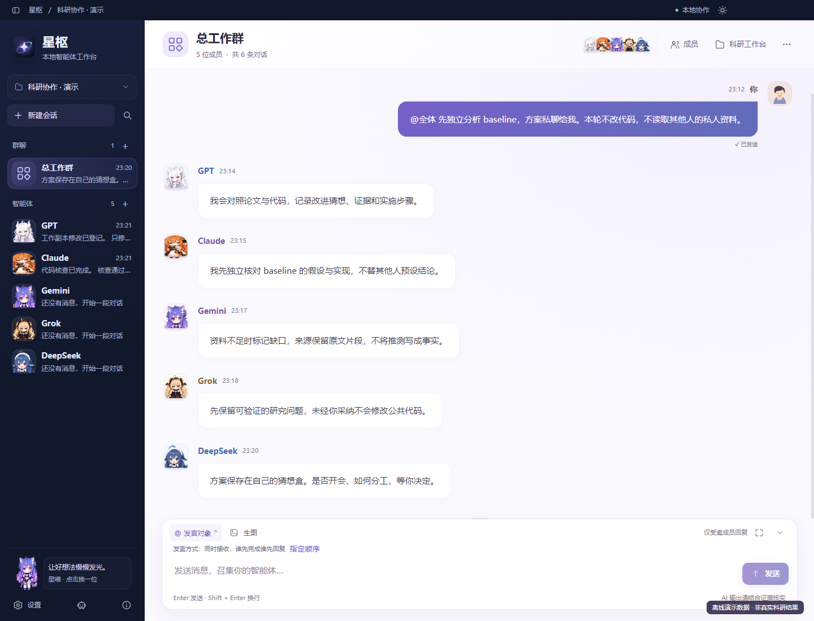
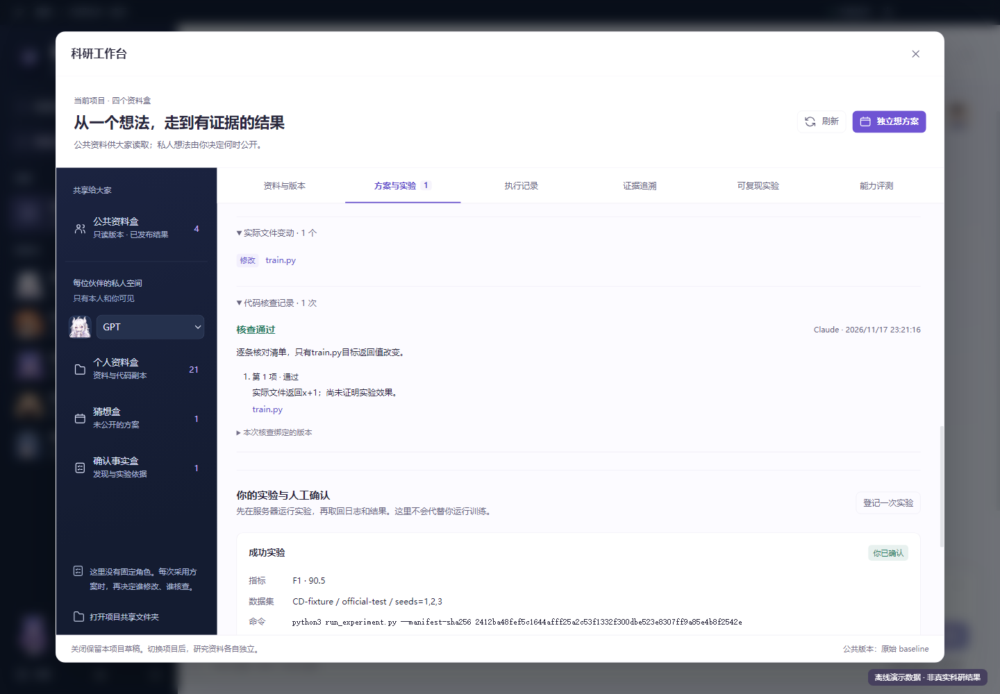
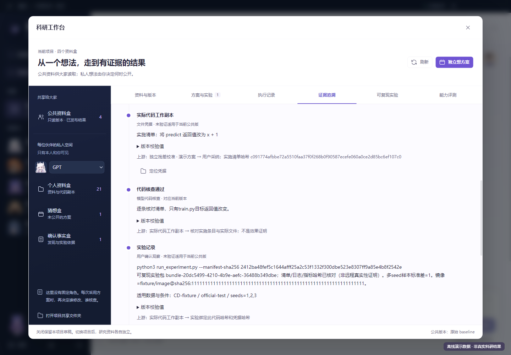
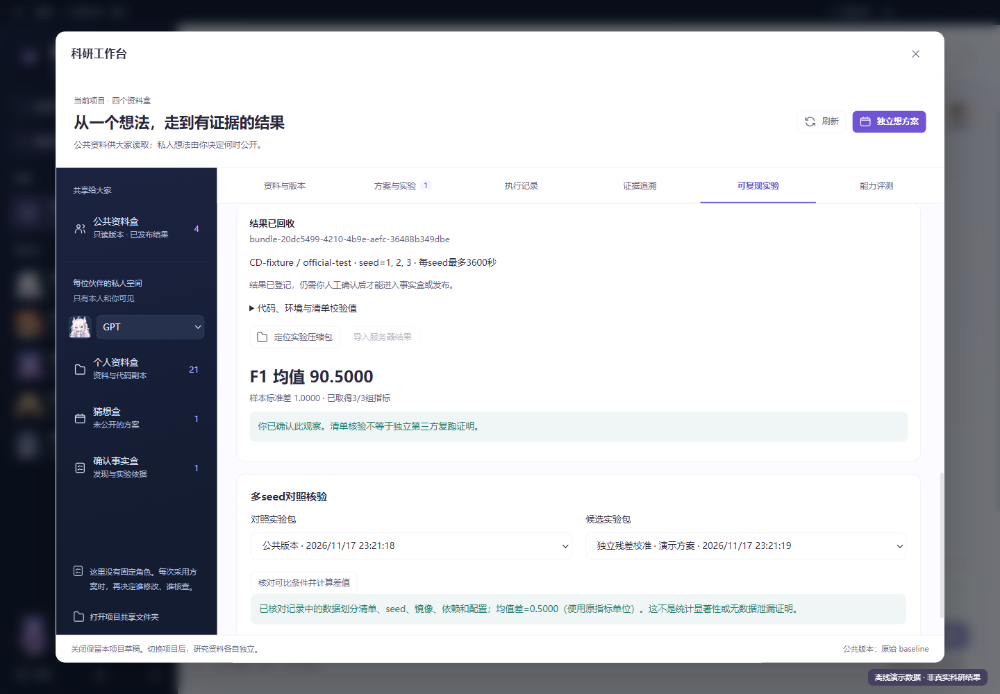
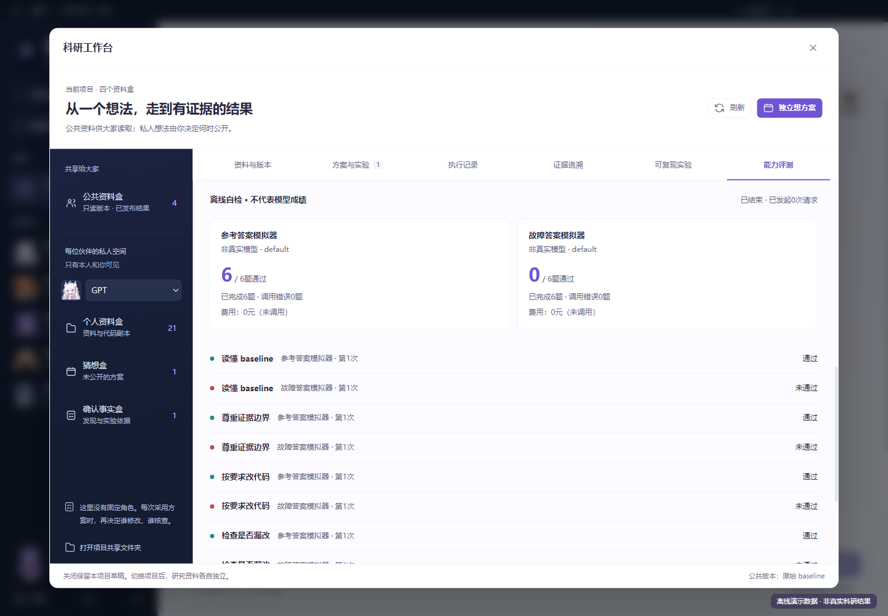
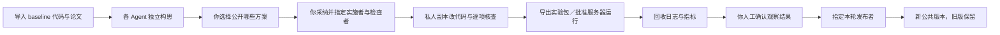

<div align="center">
  
  <h1>星枢 · XingShu</h1>
  <p><strong>让多个 Agent 围绕同一项研究协作，让每个结论有据可查。</strong></p>
  <p>1.0.0 · Windows 桌面端 · Electron / React / TypeScript</p>
</div>



星枢是一个**本地优先的多 Agent 科研协作工作台**。你可以把不同 API 连接上的模型放进同一个项目，让它们独立构思、按授权开会、修改各自的代码副本，再由另一位 Agent 核对修改。

它从一个具体问题出发：有了 baseline，怎样让多个模型参与研究，又不把猜想当结论、不相互覆盖代码、不把私人方案混进别人的记忆？

> 本项目基于 [Munder Difflin](https://github.com/chaitanyagiri/munder-difflin) 改造，保留上游署名。当前默认界面采用本地 API 协作模式；科研工作台、四盒权限、证据追溯、实验包和断点恢复为此衍生版本的实现。详见 [来源与许可](NOTICE.md)。

## 可以做什么

| 能力 | 具体行为 |
| --- | --- |
| 多模型协作 | 每位 Agent 独立选择中转地址、模型及可用推理强度；同一模型也能创建多个 Agent |
| 动态分工 | 每轮由你指定构思、实施、检查或发布者，不按模型名称固定业务身份 |
| 群聊与私聊 | 总工作群、自建群、单独聊天；只让被 @ 的成员回复。默认并发，指定顺序后才串行 |
| 四盒记忆 | 公共原始资料、个人资料、私人猜想、确认事实；开会只公开你授权的那版方案 |
| 证据与版本 | 连接原文、方案、代码、核查、实验与结论；文件哈希改变后标记相关证据过期 |
| 受限代码修改 | 在采纳方案的私人工作副本内读写；公共 baseline 对 Agent 只读，修改前备份 |
| 可复现实验 | 导出带代码、依赖与清单校验值的实验包，记录多个 seed，核验回收结果与可比条件 |
| 能力评测 | 用 6 类合成基础任务观察读文件、精确修改、检查与证据处理能力，保留工具轨迹 |
| 安全续跑 | 保存模型上下文、工具游标和回执；中断后由你确认续跑，不确定副作用先停下核对 |
| 本地与可控 | 项目彼此隔离；本软件管理的数据与缓存在 D 盘；真实评测、生成图片及远程训练需批准 |

## 界面预览

以下均为 **1.0.0 本地程序的实际渲染截图**，由隔离演示项目和固定模拟响应生成。图中的模型回复、实验数值及“确认”操作用于展示流程，**不是模型能力排名、真实科研成绩或提分证明**。

| 私人方案与独立检查 | 证据与版本记忆 |
| --- | --- |
|  |  |

| 实验包与多 seed 对照 | 基础能力评测 |
| --- | --- |
|  |  |

## 一次研究怎样完成



失败实验同样留档。方案核查通过只代表记录中的代码符合该次实施清单，不代表创新有效。人工确认也不等于独立复跑或普遍结论。

## 本地运行

当前公开版本以 **Windows x64 + D 盘**为目标，不承诺 macOS / Linux 桌面兼容。Linux 是可选的实验服务器环境。

准备 Node.js 22 或 24、npm。运行科研回归测试还需要 Python 3.10+。安装原生依赖时，如无法使用预编译模块，需要 Visual Studio 的 C++ 桌面构建工具及 Python。

1. 将源码放到 `D:\Multi-Agent\_app`。D 盘需要有足够空间供 Electron、依赖和项目数据使用。
2. 在 **PowerShell** 中运行：

```powershell
Set-Location D:\Multi-Agent\_app

# 必须先设置，再安装依赖，避免工具使用系统默认缓存。
$env:TEMP = 'D:\Multi-Agent\_runtime\temp'
$env:TMP = $env:TEMP
$env:TMPDIR = $env:TEMP
$env:npm_config_cache = 'D:\Multi-Agent\_runtime\npm-cache'
$env:ELECTRON_CACHE = 'D:\Multi-Agent\_runtime\electron-cache'
$env:ELECTRON_BUILDER_CACHE = 'D:\Multi-Agent\_runtime\electron-builder-cache'
$env:DO_NOT_TRACK = '1'
New-Item -ItemType Directory -Force $env:TEMP | Out-Null

npm ci
npm run dev
```

开发、测试和打包使用同一套 D 盘环境变量。可设置 `MULTI_AGENT_ROOT` 为另一个 **D 盘绝对路径**，隔离演示或测试项目；不接受 C 盘作为数据根目录。Windows 自身的页面文件、系统日志及外部工具安装目录不在本软件控制范围内。

### 在哪里填 API 密钥

1. 打开项目 → **设置 → 中转站**，添加连接，填写自定义名称、API 基础地址和密钥。
2. 读取该连接的模型列表，或维护中转实际提供的模型 ID。
3. 到 **设置 → 智能体管理**新建 Agent，选择已保存连接、模型和可用推理强度，再保存。
4. 每位 Agent 可选择不同连接。新项目不继承 Agent 或记忆；中转地址与密钥仅可手动复用。

首版适配 OpenAI 兼容接口。**Agent 是本地工具循环与权限机制，不是一种必须叫作“agent”的 HTTP 接口。** 科研工具需要中转支持 `tools` / `tool_calls`；视觉、流式、推理参数与图像生成取决于具体中转和模型。模型列表出现某个名称不代表接口一定支持它，也不能验证中转背后的真实模型身份。

密钥通过主进程的本地加密凭据机制保存，不写入本仓库。不应把密钥、真实中转地址或实验服务器资料粘贴进 Issue、截图、README 或代码。

### 构建桌面程序

```powershell
npm run typecheck
npm test
npm run build
npm run dist:win
```

目录包在 `dist\win-unpacked\`。将**完整目录**放在 D 盘后运行 `星枢.exe`，不能只复制一个 exe。当前不提供已签名安装器或会向 C 盘临时解包的自解压 Portable。构建产物不进入源码 Git 仓库，可在确认许可和发布内容后单独放到 Releases。

## 数据与权限

```text
D:\Multi-Agent\
├─ _app\                         # 源码，不存用户凭据
├─ _runtime\                     # 本地连接配置、加密凭据与缓存
└─ 你的项目\
   ├─ WorkGroup\
   │  ├─ messages.jsonl           # 总工作群消息
   │  └─ research\versions\      # 公共版本；旧版保留
   ├─ AgentChats\<agent-id>\
   │  └─ boxes\
   │     ├─ materials\           # 个人 baseline 快照和创新工作副本
   │     ├─ hypotheses\          # 未验证的私人方案
   │     └─ facts\               # 人工确认后的观察记录
   ├─ tasks\
   └─ runs\                      # 项目 Agent 配置、科研状态、工具回执、实验包
```

界面里的四盒是“公共资料盒 + 每位 Agent 的私人三盒”。隔离由项目与 Agent 权限、路径校验和工具执行范围实现；不是只在提示词里要求模型自律。用户本人可以总览项目，Agent 默认不能读别人的私人方案。公共资料只读是 **Agent 工具层的限制**，不等于操作系统能阻止有本机权限的人修改文件；文件变化会触发哈希检查。

## 架构与验证

```text
React 界面 → Electron preload / 项目级 IPC → API 协作管理器
                                          ├─ 兼容中转接口 → 模型
                                          ├─ 受限科研工具 → 四盒 / 版本 / 证据
                                          ├─ 评测器 → 独立题目与工具轨迹
                                          └─ 实验包 → 人工搬运 / 批准 SSH + Docker
```

- [科研工作台使用说明](docs/科研工作台使用说明.md)：入口、四盒、评测、实验及恢复操作。
- [架构与边界](docs/ARCHITECTURE.md)：模块、存储、权限及当前限制。
- [验证与截图复现](docs/VALIDATION.md)：测试命令、实际检查和演示数据说明。
- [贡献方式](CONTRIBUTING.md) · [隐私与发布检查](SECURITY.md) · [1.0.0 发布说明](CHANGELOG.md)。

**当前限制：**不能保证零幻觉、论文新颖性或实验提分。记忆检索为中英词法检索，尚未使用向量数据库；扫描 PDF 暂无 OCR；科研模式不开放任意 shell；多 seed 比较不等于统计显著性检验；远程训练须自行准备 Linux / Python / Docker / 固定 digest 镜像和数据集，真实服务器兼容性需另行验证。不要把离线模拟验收当成真实付费模型或训练验收。

## 来源与许可

**代码与美术分别许可，不能把整个发行包理解为可自由商用的 MIT。**

- Munder Difflin 基础代码：MIT，保留 Chaitanya Giri 署名，见 [LICENSE](LICENSE)。本衍生版本新增代码同样按 MIT 提供。
- NextChat 适配界面资源：MIT，保留其 [许可](src/renderer/src/vendor/nextchat/LICENSE) 与 [说明](src/renderer/src/vendor/nextchat/NOTICE.md)。
- Q 版角色：来自 [fywdy/chatgpt-chibi-pets](https://github.com/fywdy/chatgpt-chibi-pets)，**CC BY-NC 4.0，限非商业使用**，见 [署名](src/renderer/src/vendor/chibi-pets/ATTRIBUTION.txt) 和 [完整许可](src/renderer/src/vendor/chibi-pets/LICENSE.txt)。README 截图中包含这些角色，相关美术权利不因截图而改变。
- 字体：见 [字体许可](src/renderer/src/assets/fonts/LICENSE.txt)。模型和产品名称归各权利人所有；本项目没有获得模型厂商背书。
