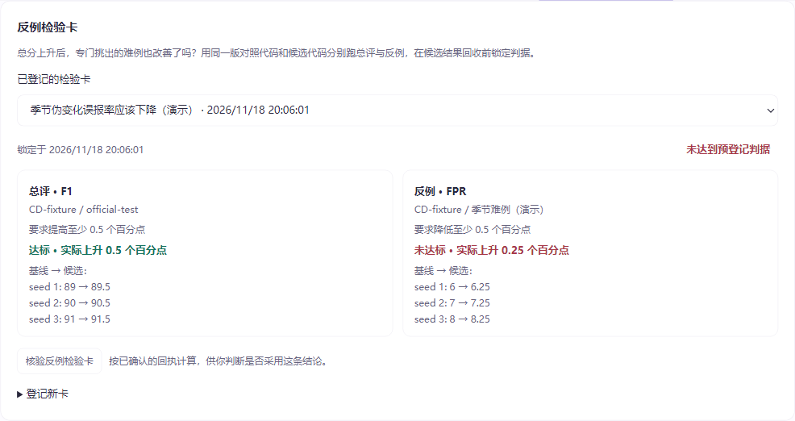

# 反例检验卡：涨分后，机制主张能不能站住？

**定位：**星枢已有项目隔离、私人方案、代码核查和多 seed 对照。这张卡把「为什么涨分」进一步变成一份跑前登记、跑后可重算的实验记录。它不是一键发论文，也不是对算法有效性的认证。

## 最近的 GitHub 对照

以下为 2026 年 11 月 18 日核对的公开源码快照。日期是所查提交日期，不是每项特性的首发日期。结论只覆盖列举的公开实现与文档。

| 项目和固定快照 | 已经做了什么 | 对星枢的启发 |
| --- | --- | --- |
| [FAROS，2026-10-21](https://github.com/OpenNSWM-Lab/FAROS/blob/60ce4bc235f169d71f2d11dbe37445b4e402b528/README.md) | `PlanPackage` 记录目标、假设和验收条件；ReviewX 核验主张与证据并将反馈转成修订 | 科研合同、评审和证据追踪已有成熟先例；不能把整个流程当作我们的新意。 |
| [KalarisLabs/research-agent-skills，2026-11-17](https://github.com/KalarisLabs/research-agent-skills/blob/a74b0dbe5fa865d73b9f250ba5b0c9f107bd1baa/README.md) | 提供预登记、竞争解释、可区分预测和证伪阈值；公开案例留有被反驳的假设 | 不能只写一条提示词让模型事后判断。跑前要写下什么算过关。 |
| [AI Evaluation Lab，2026-11-13](https://github.com/kaulastudies/ai-evaluation-lab/blob/c619f1335d3039eecdee0502f470b9f323fe84f4/README.md) | 为 Agent 能力评测冻结候选，保留正负对照、确定性核验和无需模型的回放 | 评测 Agent 的体验不同于研究者验证一个自己采用的代码创新；同样可以用程序判断可检查的指标。 |
| [EvalSeal，2026-11-11](https://github.com/patibandlavenkatamanideep/evalseal/blob/2a79428b30c5acae1d062b1991a90f453f84fb7b/README.md) | 对 LLM 评测预登记、封存回执、做成对比较，并支持分项门槛 | 预登记和回执核验已有现成实现；星枢把它们接到公共对照、私人实现、独立核查和难例检验。 |
| [Anti-Autoresearch，2026-11-06](https://github.com/wanshuiyin/Anti-Autoresearch/blob/014a1e7cd63f1656603daaeeadb856aed1df6869/README.md) | 写完后审计基线是否公平、数字有无出处、消融能否支持归因等 | 把部分检查提前到训练之前，给反例单独选样本和指标，回收后还能复核。 |
| [DeepScientist，2026-06-28](https://github.com/ResearAI/DeepScientist/blob/b36624417f0c6b8238ec02db37b94d6db2faa5b0/README.md) | 本地工作台保留 baseline 复现、实验分支、产物和后续迭代 | 基础复现和积累产物已经有人做；差异应体现在一次实验怎样推翻一个听起来很好的解释。 |

在这些快照里未核实到与星枢相同的桌面交互组合：**同一公共代码与同一候选代码上的两对实验、候选回收前锁定实际实验包与改善阈值、从核过的凭据计算成对结果，并单独展示反例是否过关**。这不是对所有 GitHub 项目的唯一性结论。

## 一次遥感变化检测案例

> 主张：新模块能减少季节伪变化带来的误报。这里的数值仅用于演示。

1. 在「科研工作台 → 可复现实验」为总评和季节难例各准备一对实验包：公共 baseline 一份、同一已核查候选一份。两组用不同划分清单；每组使用相同的镜像、依赖、配置与至少两个 seed。
2. 展开「反例检验卡 → 登记新卡」。总评选 **F1 至少提高 0.5 个百分点**；难例选 **误报率至少降低 0.5 个百分点**。自己指定样本和阈值。训练脚本须按实验包填写的指标键写入数值。
3. 锁定后执行或手工搬运实验包，回收日志和指标，并逐个确认。打开检验卡核验。如果总评 F1 `+0.5` 但难例误报率反而 `+0.25` 个百分点，仍显示「未达到预登记判据」，并显示每个 seed 的原值和候选值。选择合适的反例和解释结果由研究者完成。

该卡保存项目内、允许重启恢复。确认和凭据不完整时显示「还缺可比证据」；代码、配置信息或结果文件变动后需重新核对。它只计算已登记判据，不会代写事实、自动发布、保证统计显著性，或证明本机文件和服务器结果的真实性。划分清单不同不代表样本一定独立，也不能证明训练脚本实际使用了该清单；需在训练参数及日志中核对。锁定保证的是**星枢内先登记再回收候选结果**，无法知道用户是否已在外部看到结果。

图中是应用实际渲染的离线验收案例，指标为合成数据。

2026-11-18 验收：173 项回归通过；Windows 目录包通过 30 项 Electron 检查。使用模拟结果完成界面登记、回收、人工确认、冲突展示、进程重启重算和新项目隔离验证。真实模型请求和真实 GPU 训练均为 0。
